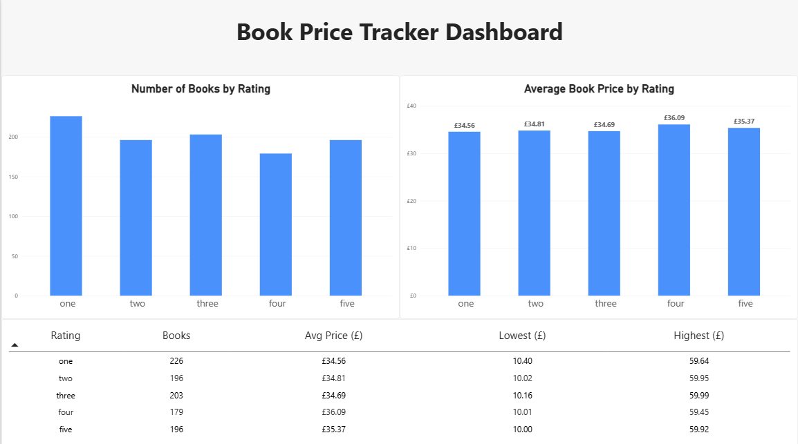

# Book Price Tracker: Local Data Engineering Pipeline

## Overview

This project collects book information from the Books to Scrape practice website and turns it into a dashboard-ready dataset.

The pipeline scrapes 1,000 books, loads the data into PostgreSQL, cleans and summarizes it with dbt, and visualizes the results in Power BI.

## Pipeline

```text
Scrapy (Docker) -> CSV -> Python -> PostgreSQL (Docker Compose) -> dbt -> Power BI
```

## Tools Used

- Python and Scrapy
- PostgreSQL and pgAdmin
- psycopg
- dbt
- Power BI
- Git and GitHub

## Project Structure

```text
price_tracker_pipeline/
|- data/raw/                    # Generated scraper output
|- price_tracker/                # Scrapy project and book spider
|  `- spiders/books_spider.py
|- price_tracker_dbt/            # dbt models and tests
|- Dockerfile                    # Container instructions for the scraper
|- .dockerignore                 # Files excluded from the Docker build
|- compose.yaml                  # Docker PostgreSQL service definition
|- .env.example                  # Database configuration template
|- sql/init.sql                  # Creates the Docker raw_books table
|- load_books.py                 # Loads CSV data into PostgreSQL
|- requirements.txt
|- scrapy.cfg
`- README.md
```

## How It Works

1. Scrapy collects the book title, price, availability, rating, URL, source, and scrape timestamp.
2. The scraper exports the results to `data/raw/books.csv`.
3. `load_books.py` loads the CSV into the PostgreSQL `raw_books` table.
4. dbt creates a cleaned staging view named `stg_books`.
5. dbt creates `book_rating_summary`, a dashboard-ready summary table.
6. Power BI connects to the PostgreSQL summary table and displays the results.

## Run the Scraper

From the project folder in PowerShell:

```powershell
python -m venv .venv
.\.venv\Scripts\Activate.ps1
python -m pip install -r requirements.txt
scrapy crawl books -O data\raw\books.csv
```

## Run the Scraper with Docker

Build the Docker image:

```powershell
docker build -t build-price-scraper .
```

Run the scraper container and save the CSV output to your local `data/raw` folder:

```powershell
docker run --rm -v "${PWD}\data\raw:/app/data/raw" build-price-scraper
```

## Run PostgreSQL with Docker Compose

Copy `.env.example` to `.env`, then replace both password values with the same private password.

```powershell
Copy-Item .env.example .env
docker compose up -d
```

Docker starts a separate PostgreSQL database at `localhost:5433`. It does not change the existing local PostgreSQL database at `localhost:5432`.

Check its status with:

```powershell
docker compose ps
```

With `DB_PORT=5433` in `.env`, run the loader to send `books.csv` to the Docker database:

```powershell
python load_books.py
```

## Local PostgreSQL Setup (Optional)

The original local PostgreSQL version uses port `5432`. Create a database named `price_tracker`, then create the raw table:

```sql
CREATE TABLE raw_books (
    id BIGSERIAL PRIMARY KEY,
    product_name TEXT NOT NULL,
    price_gbp NUMERIC(10, 2),
    availability TEXT,
    rating TEXT,
    product_url TEXT NOT NULL,
    source TEXT NOT NULL,
    scraped_at TIMESTAMPTZ NOT NULL,
    loaded_at TIMESTAMPTZ NOT NULL DEFAULT NOW()
);
```

## Load Data into PostgreSQL

Install project dependencies, then run the loader. The `.env` file controls whether it uses the local database (`5432`) or Docker database (`5433`).

```powershell
python -m pip install -r requirements.txt
python load_books.py
```

## Run dbt Models and Tests

For the original local database:

```powershell
cd price_tracker_dbt
dbt run
dbt test
```

For the Docker PostgreSQL database, configure a `docker` output in `~/.dbt/profiles.yml` with port `5433`, then run:

```powershell
cd price_tracker_dbt
dbt debug --target docker
dbt run --target docker
dbt test --target docker
```

## Dashboard



The Power BI dashboard includes:

- Number of books by rating
- Average book price by rating
- Lowest and highest price for each rating

## Data Source

This project uses [Books to Scrape](https://books.toscrape.com/), a practice website designed for web-scraping learning projects.
